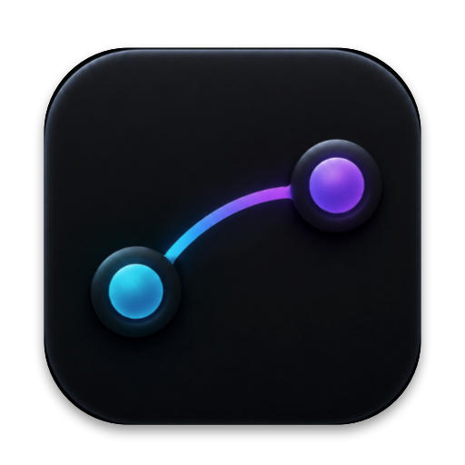
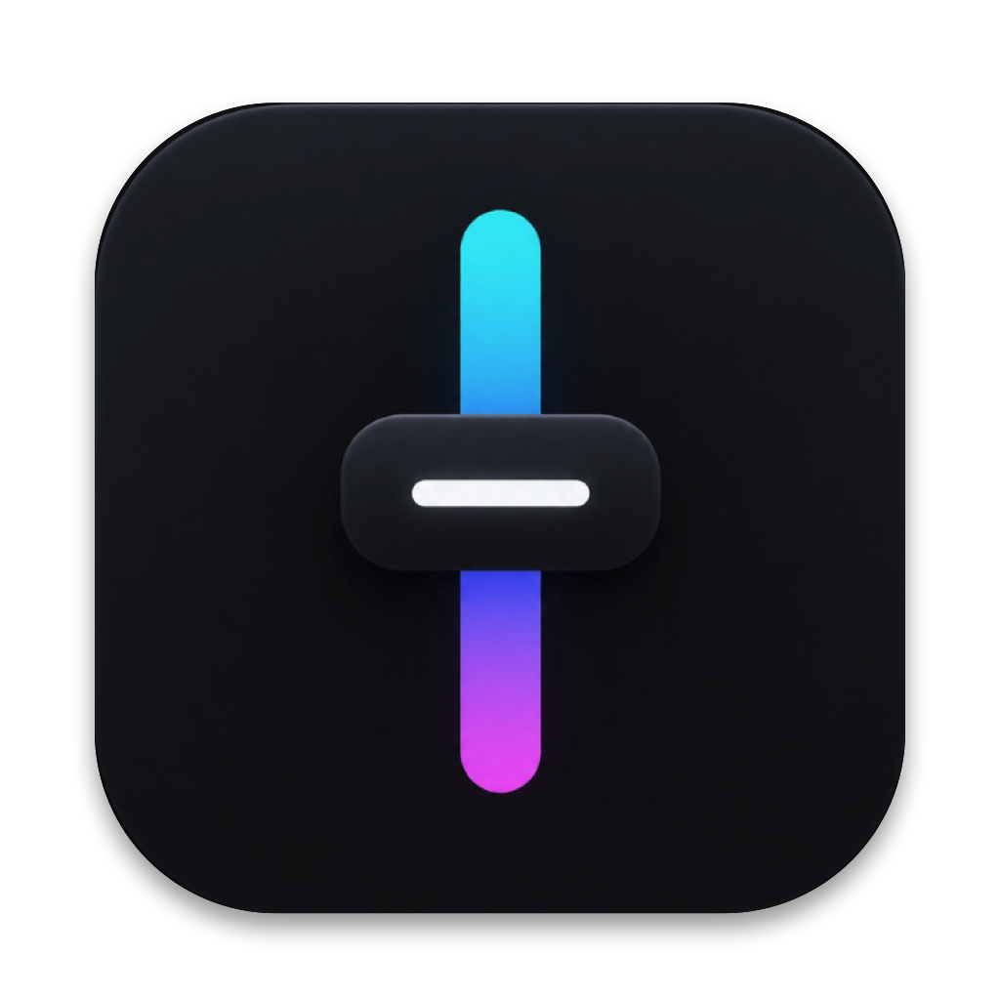
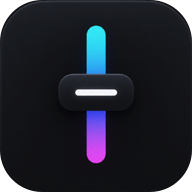

<div align="center">


# TouchStage

**Turn your Android phone or tablet into a wireless MIDI controller for your Mac.**

Design your own touch surfaces, play them over Wi-Fi, and use them in any DAW. No drivers, no cables, no manual pairing.

[](#requirements)
[](#how-it-works)
[](#how-it-works)
[](LICENSE)

[Download APK](TouchStage.apk) · [Quick Start](#quick-start) · [How it works](#how-it-works) · [Build from source](#building-from-source)

</div>

<!-- TODO: add a hero screenshot or GIF here, e.g. assets/screenshots/hero.png
     (Android app in use next to the Editor and a DAW). It's the single biggest README upgrade. -->

---

## Why TouchStage?

Most MIDI controller apps are either closed ecosystems or depend on heavy middleware. TouchStage is deliberately small and direct:

- **Plug-and-play:** the Mac exposes a native virtual MIDI port, so your DAW sees it right away.
- **Low latency:** raw 3-byte MIDI messages travel as binary UDP datagrams, with no protocol overhead.
- **Your layout, your rules:** build custom multi-page surfaces in a visual editor and push them to the device live.
- **Zero configuration:** the phone finds the Mac on the local network by itself.

## The Suite

TouchStage is made of three native apps that work together:

| App | Platform | Role |
|---|---|---|
|  **Bridge** | macOS (menu bar) | Receives UDP from the device and exposes a CoreMIDI port |
|  **Editor** | macOS | Visual designer for MIDI surfaces, with live sync to the device |
|  **Controller** | Android | The touch instrument you actually play |

```
┌────────────────┐   UDP (MIDI, 3 bytes)   ┌────────────────┐   CoreMIDI   ┌─────────┐
│   Controller   │ ──────────────────────▶ │     Bridge     │ ───────────▶ │   DAW   │
│   (Android)    │ ◀── UDP discovery ───── │    (macOS)     │              └─────────┘
│                │ ◀── TCP layout sync ─── │     Editor     │
└────────────────┘                         └────────────────┘
```

###  Bridge (macOS)

A lightweight menu bar companion that talks directly to macOS audio.

- **Native CoreMIDI port:** appears as `TouchStage Controller` in Ableton Live, Logic Pro, Reaper, Pro Tools and any other CoreMIDI-aware app.
- **Fast UDP receiver:** ingests raw binary MIDI datagrams.
- **Auto-discovery beacon:** announces itself on the local network so devices connect on their own.
- **Status monitor:** shows connected devices, active IP endpoints and live signal activity.

###  Editor (macOS)

A desktop canvas for designing multi-page MIDI surfaces.

- **Visual canvas:** snap-to-grid, multi-selection, alignment tools and undo/redo.
- **Component library:**
  - **Faders:** vertical or horizontal; standard, inverted or centered; optional VU meters; capsule or clean labels.
  - **Rotary knobs:** continuous rotation, center-cap or bottom-badge readouts, configurable font size.
  - **Pads and buttons:** momentary or toggle, square or circular, with a tactile glass-gradient look.
  - **XY pads and text labels:** two-axis CC modulation and section headers.
- **Live sync:** push layouts to connected devices instantly over TCP.

###  Controller (Android)

A touch-first instrument for phones and tablets.

- **Hardware-accelerated canvas:** custom 2D rendering for fluid 60/120 FPS multi-touch.
- **Multi-page layouts:** quick slide transitions, tab flyout navigation, configurable sidebar orientation.
- **Auto-connect:** finds the Bridge on your Wi-Fi with no setup.
- **Haptic feedback:** instant vibration on touch.

<!-- TODO: add a screenshots table (Bridge | Editor | Controller), e.g.
|  |  |  | -->

## Requirements

- **Mac:** macOS 11.0 (Big Sur) or higher
- **Android:** Android 5.0 (Lollipop, API 21) or higher
- Both devices on the **same Wi-Fi network** (5 GHz recommended for best latency)
- Any DAW or synth that accepts CoreMIDI input

## Quick Start

**1. Start the Bridge**

```bash
./run_bridge.sh
```

TouchStage appears in your menu bar.

**2. Install the Android app**

Download [`TouchStage.apk`](TouchStage.apk) and install it on your device (you may need to allow installs from unknown sources), or [build it from source](#building-from-source). Open the app while on the same Wi-Fi network as your Mac. It pairs automatically.

**3. Pick the port in your DAW**

Enable the MIDI input named **`TouchStage Controller`** in your DAW's MIDI preferences and map or play away.

**4. (Optional) Design your own layout**

```bash
./run_editor.sh
```

Arrange faders, knobs, pads and XY pads, set MIDI channels and CC numbers, then click **Sync to Device**.

## How it works

| Channel | Protocol | Port | Purpose |
|---|---|---|---|
| MIDI events | UDP, raw 3-byte MIDI datagrams | `9000` / `9001` | Controller → Bridge, played notes and CC |
| Discovery | UDP broadcast beacon | `9002` | Bridge announces itself; the device connects automatically |
| Layout sync | TCP, JSON | `9000` | Editor → Controller, pushes surfaces and templates |
| DAW output | Apple CoreMIDI | Virtual Port | Bridge exposes the virtual port `TouchStage Controller` |

## Project structure

```
touchstage/
├── android/          # Android Controller app
├── macos/            # Bridge and Editor (macOS)
├── layouts/          # Layout templates
├── assets/           # Icons and images
├── run_bridge.sh     # Launch the Bridge
├── run_editor.sh     # Launch the Editor
├── build_android.sh  # Build TouchStage.apk
└── TouchStage.apk    # Prebuilt Android app
```

## Building from source

### Prerequisites
- **macOS:** Xcode Command Line Tools (`clang` / `swiftc`)
- **Android:** Android SDK (API 21+) and JDK 17+ (or Android Studio)

```bash
# macOS apps (Bridge and Editor)
./macos/build_all.sh

# Android app (outputs TouchStage.apk)
./build_android.sh
```

## Troubleshooting

<details>
<summary><b>The Android app doesn't find my Mac</b></summary>

- Confirm both devices are on the same network and SSID.
- Some routers enable **client/AP isolation** (common on guest networks), which blocks device-to-device traffic. Turn it off or use another network.
- Check that the macOS firewall isn't blocking the Bridge.
</details>

<details>
<summary><b>The port doesn't show up in my DAW</b></summary>

- Make sure the Bridge is running (look for it in the menu bar).
- Restart the DAW or rescan MIDI devices after starting the Bridge.
</details>

<details>
<summary><b>I notice latency or dropped messages</b></summary>

- Prefer a 5 GHz network, close to the router, with little traffic.
- Avoid public or crowded networks for live use.
</details>

## Roadmap

- [ ] Bidirectional MIDI feedback (motorized fader emulation & LED indicators)
- [ ] USB-tethered MIDI mode for zero-wireless environments
- [ ] Additional components (piano roll keyboard, step sequencer)
- [ ] iOS client version

## Contributing

Issues and pull requests are welcome. If you're proposing a larger change, please open an issue first to discuss it.

## License

Released under the [MIT License](LICENSE).
