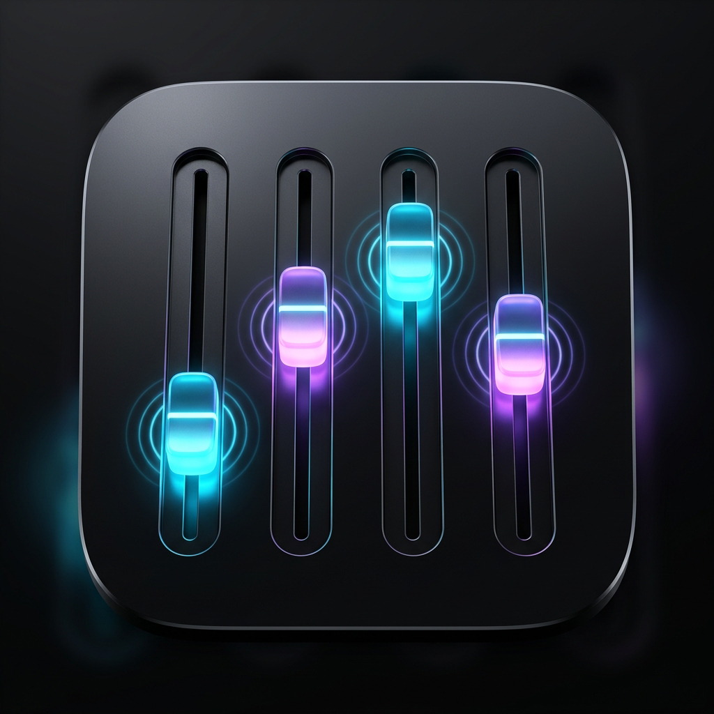

<p align="center">
  
</p>

<h1 align="center">TouchStage</h1>

<p align="center">
  <b>Minimalist, high-performance wireless MIDI suite for macOS and Android.</b><br>
  Sub-millisecond latency via binary UDP and native Apple CoreMIDI.
</p>

<p align="center">
  
  
  
  
</p>

---

## The Suite

TouchStage is composed of three native apps engineered to work seamlessly together:

### 1. TouchStage Bridge (macOS)
Lightweight menu bar companion that interfaces directly with macOS audio subsystems.
* **Native CoreMIDI Port:** Exposes `TouchStage Controller` to any DAW (Ableton Live, Logic Pro, Reaper, Pro Tools, etc.) with zero drivers required.
* **High-Speed UDP Receiver:** Ingests raw 3-byte binary MIDI datagrams with sub-millisecond response.
* **Auto-Discovery Beacon:** Broadcasts local UDP announcements so mobile devices connect automatically.
* **Status Monitor:** Displays connected devices, active IP endpoints, and real-time signal activity.

### 2. TouchStage Editor (macOS)
Dedicated desktop canvas to design and customize multi-page MIDI surfaces.
* **Visual Canvas:** Full snap-to-grid layout editing with multi-selection, alignment tools, and undo/redo history.
* **Rich Component Library:**
  * **Faders:** Vertical or horizontal, behaviors (standard, inverted, centered), optional VU meters, and capsule or clean labels.
  * **Rotary Knobs:** Continuous rotation, center cap or bottom badge numeric readouts, and configurable font sizing.
  * **Illuminated Pads & Buttons:** Momentary or toggle, tactile 3D glass gradient shading, square or circular shapes.
  * **XY Pads & Text Labels:** Dual-axis CC modulation and section headers.
* **Live TCP Sync:** Broadcasts updated layouts and templates to connected mobile devices instantaneously.

### 3. TouchStage Controller (Android)
Touch-optimized performance instrument running natively on Android phones and tablets.
* **Hardware-Accelerated Canvas:** Custom 2D rendering pipeline maintaining fluid 60/120 FPS multi-touch response.
* **Multi-Page Layouts:** Fast slide transitions with tab flyout navigation and customizable sidebar orientation.
* **Zero Configuration:** Automatically discovers macOS Bridge instances on the local Wi-Fi network.
* **Tactile Haptic Feedback:** Instant vibration feedback on touch interactions.

---

## Quick Start

### 1. Start the Bridge
```bash
./run_bridge.sh
```
*TouchStage appears in your macOS menu bar.*

### 2. Launch the Mobile App
Install [`TouchStage.apk`](TouchStage.apk) on your Android device (or build from source). Open the app on the same Wi-Fi network — it pairs with your Mac automatically.

### 3. Design or Edit Layouts (Optional)
```bash
./run_editor.sh
```
Customize templates, adjust MIDI channels/CC assignments, and click **Sync to Device**.

---

## Building from Source

```bash
# Build macOS Suite (Bridge & Editor)
./macos/build_all.sh

# Build Android App (TouchStage.apk)
./build_android.sh
```

---

## License

Available under the [MIT License](LICENSE).
